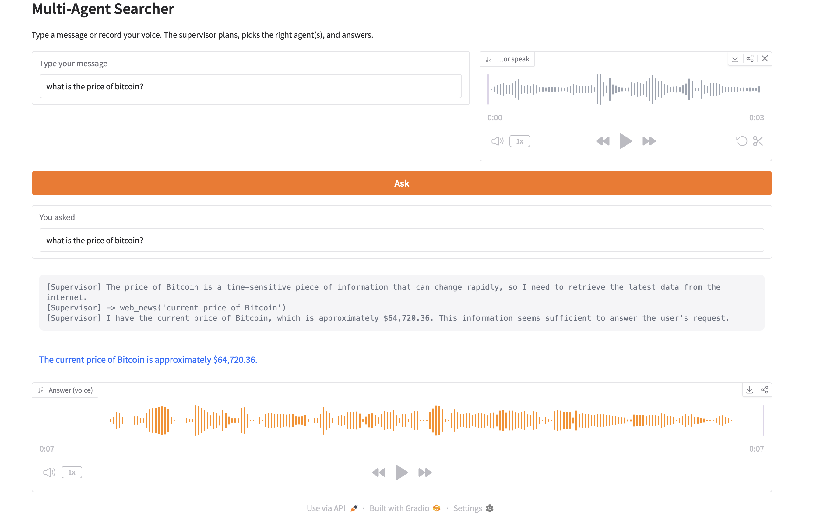
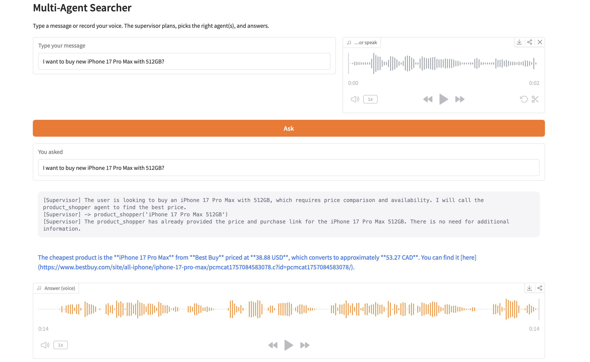

# Multi-Agent Searcher

An assistant where an LLM "supervisor" decides which agent should handle the question. It can chain a few agents for one question. You can type or talk to it, and it answers in text and voice.



## Agents

- `web_news` - searches the latest news on DuckDuckGo (no API key needed)
- `news_rag` - answers from a small local news database (Chroma)
- `product_shopper` - searches for a product, finds the cheapest listing and converts the price to CAD. It's a LangChain agent with two tools, `compare_prices` and `convert_to_cad`.
- `llm` - normal questions, explanations, math

## How it works

The supervisor gets the question and the list of agents with their descriptions. It decides on the next step and returns JSON: call an agent (and with what input) or finish. After each agent runs, it sees the result and decides again. The limit is 4 steps; after that it writes the answer from whatever it has.

To add a new agent, implement `run(query)` and add it in `build_default_assistant()` in `VoiceAssistant.py` with a good description. The supervisor picks agents based on the description, so the wording matters.

Voice: the browser records the audio, Whisper turns it into text, and the answer is read out with OpenAI TTS (`gpt-4o-mini-tts`). Nothing audio-related needs to be installed on the server.

Notes:
- The exchange rates in `convert_to_cad` are fixed, not live.
- Prices are parsed from search snippets, so sometimes it doesn't find any.
- The news database is just 8 sample articles. It gets created in `chroma_db/` on the first run.

## Screenshots





## Running it

Python 3.12 and an OpenAI key.

```bash
pip install -r requirements.txt
```

`.env`:

```
OPENAI_API_KEY=sk-...
```

```bash
python3 app.py
```

Then open http://127.0.0.1:7860. Some browsers block the audio from autoplaying until you click on the page once.

Some questions to try:
- "What is the latest news about SpaceX today?" -> web_news
- "Tell me EV battery news and explain why it matters" -> news_rag then llm
- "Cheapest iPhone 15 price in CAD" -> product_shopper
